# Ludoteca Tan: gestión de clientes y préstamos

Este proyecto es la parte frontend de una aplicación de ludoteca hecha con Angular y Angular Material. En esta guía se explican las dos páginas ilustradas: **Clientes** y **Préstamos**. Las capturas están tomadas únicamente de `fotos/hazlotu/`.

## Puesta en marcha

Necesitas Node.js y npm instalados. Desde la carpeta del proyecto, instala las dependencias y arranca el servidor de desarrollo:

```bash
npm install
npm start
```

Angular mostrará la aplicación en `http://localhost:4200`. La página inicial redirige al catálogo; puedes abrir las páginas explicadas en:

- Clientes: `http://localhost:4200/clients`
- Préstamos: `http://localhost:4200/loans`

El frontend se comunica con una API en `http://localhost:8080`. Para que las listas y las operaciones de guardar o eliminar funcionen, el backend debe estar iniciado y ofrecer los endpoints que consumen los servicios de clientes y préstamos.

## 1. Página de Clientes

La ruta `/clients` muestra una tabla con el **identificador** y el **nombre** de cada cliente. En cada fila hay acciones para modificar o eliminar el registro, y el botón **Nuevo cliente** abre el formulario de creación.

El formulario se comparte para crear y modificar clientes. El identificador no se puede editar; el nombre es obligatorio. Al guardar, el servicio envía el cliente al backend. Si se confirma una eliminación, se borra el registro y se vuelve a cargar la lista.

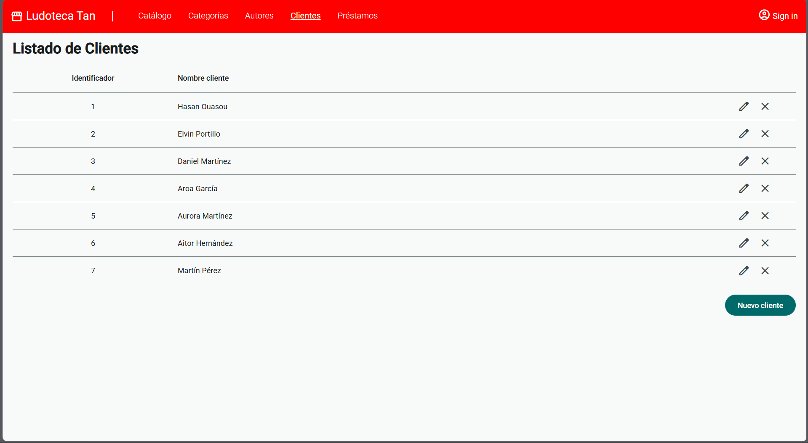

### Crear un cliente

Pulsa **Nuevo cliente**, escribe su nombre y selecciona **Guardar**. El identificador lo asigna el sistema.

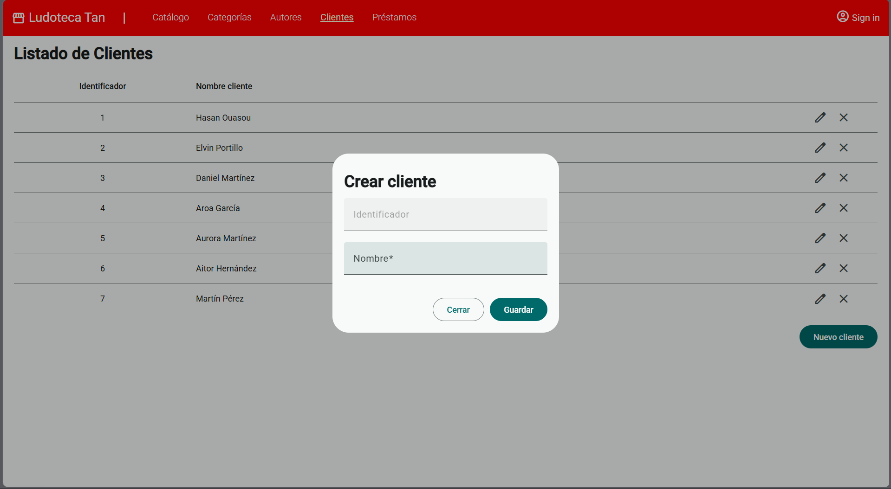

### Modificar o eliminar un cliente

El lápiz abre el formulario con los datos del cliente seleccionado. El icono de borrar solicita confirmación antes de eliminarlo.

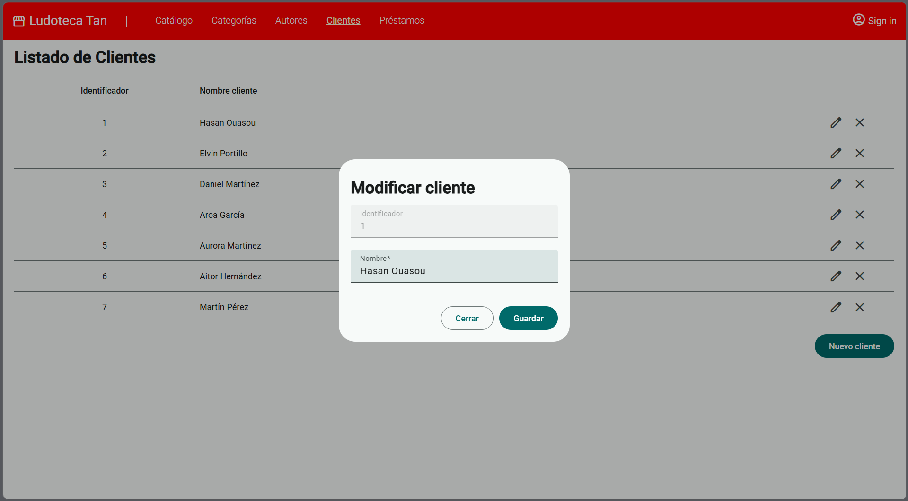

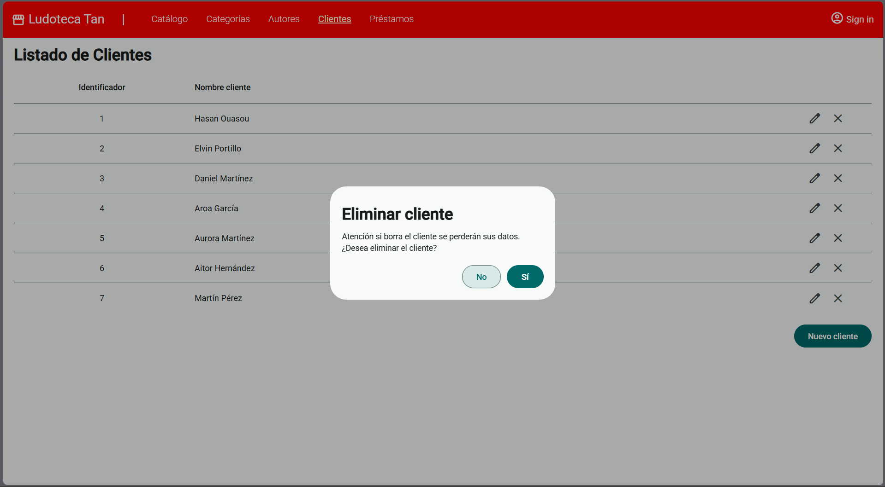

## 2. Página de Préstamos

La ruta `/loans` presenta una tabla con el identificador del préstamo, el juego, el cliente, la fecha de inicio y la fecha de devolución. Desde esta página puedes crear, modificar o eliminar préstamos.

La lista está paginada y permite elegir 5, 10 o 20 filas por página. Sobre la tabla hay filtros por juego, cliente y fecha del préstamo. **Filtrar** aplica la búsqueda y **Limpiar** borra los criterios y vuelve a mostrar los resultados sin esos filtros.

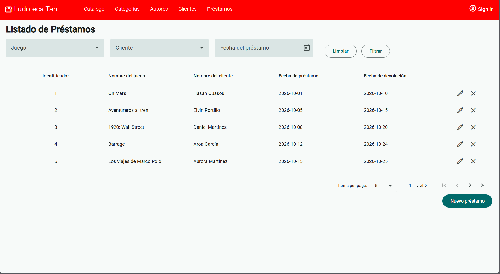

### Filtrar y recorrer los resultados

Puedes combinar los criterios disponibles para encontrar préstamos concretos. El selector de fecha utiliza un calendario y el paginador permite avanzar por los resultados.

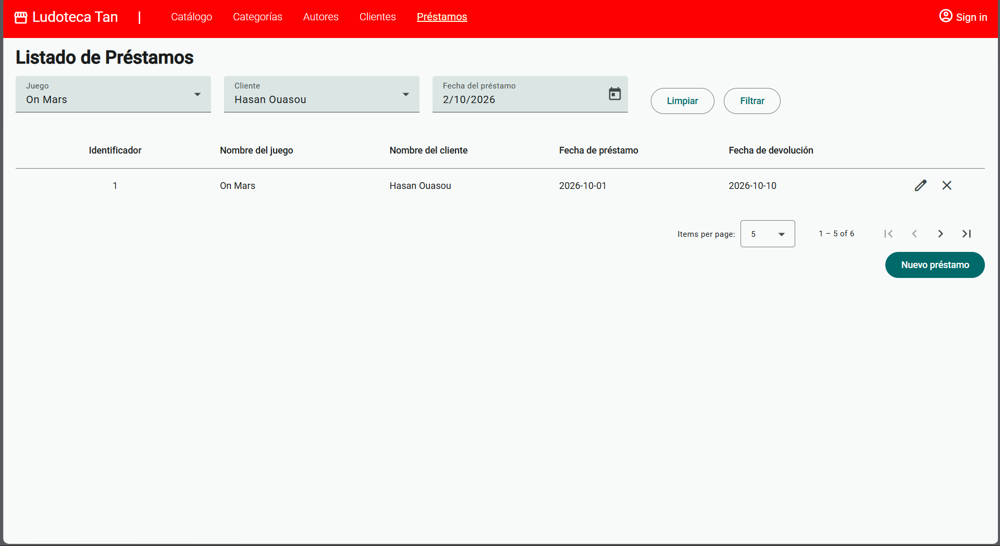

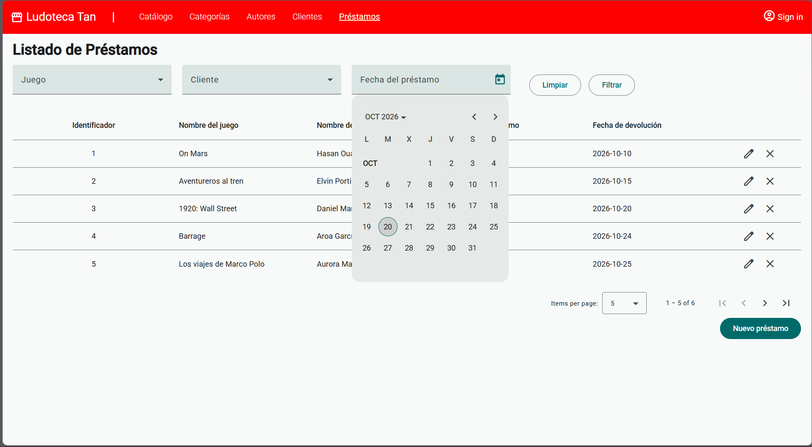

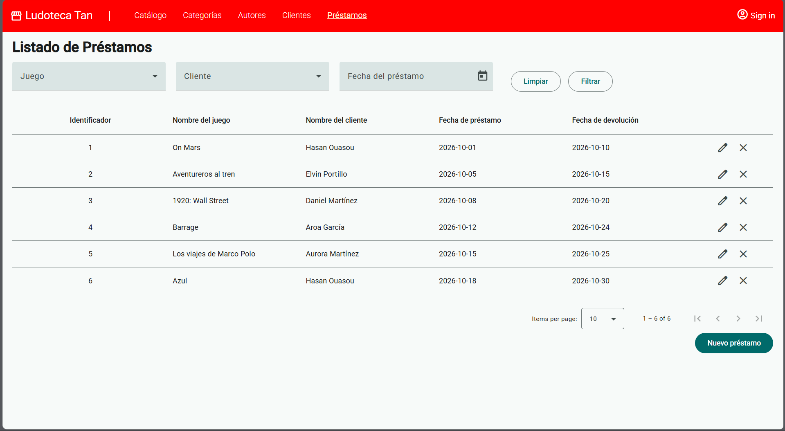

### Crear o modificar un préstamo

El formulario permite elegir un juego y un cliente de las listas disponibles, además de indicar las fechas de inicio y devolución. Al editar, se cargan los datos del préstamo seleccionado.

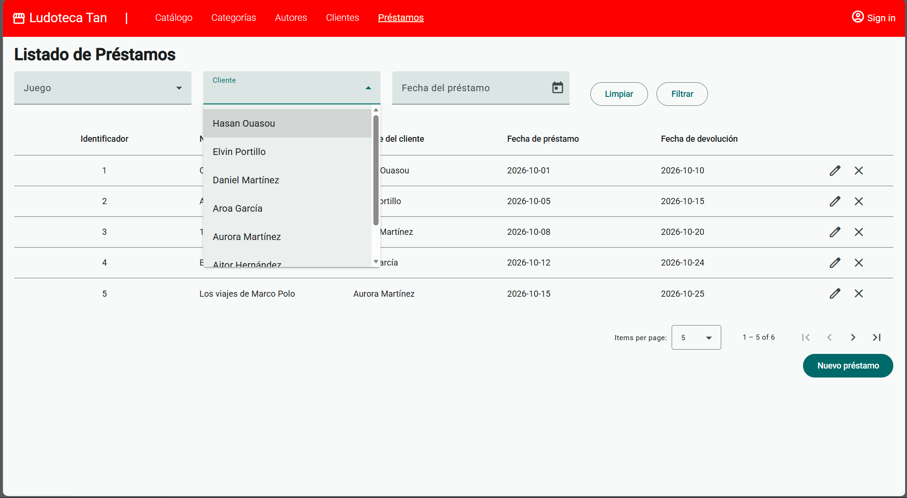

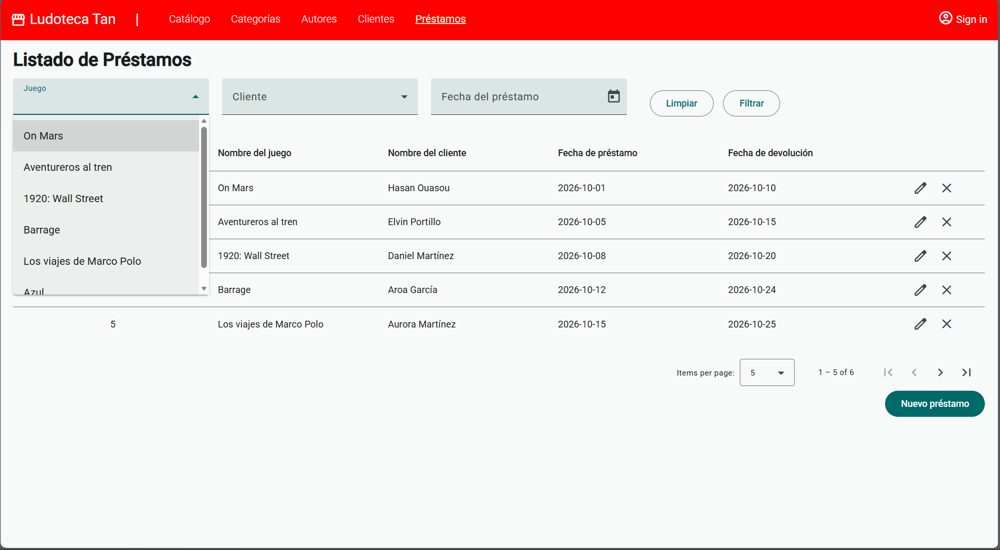

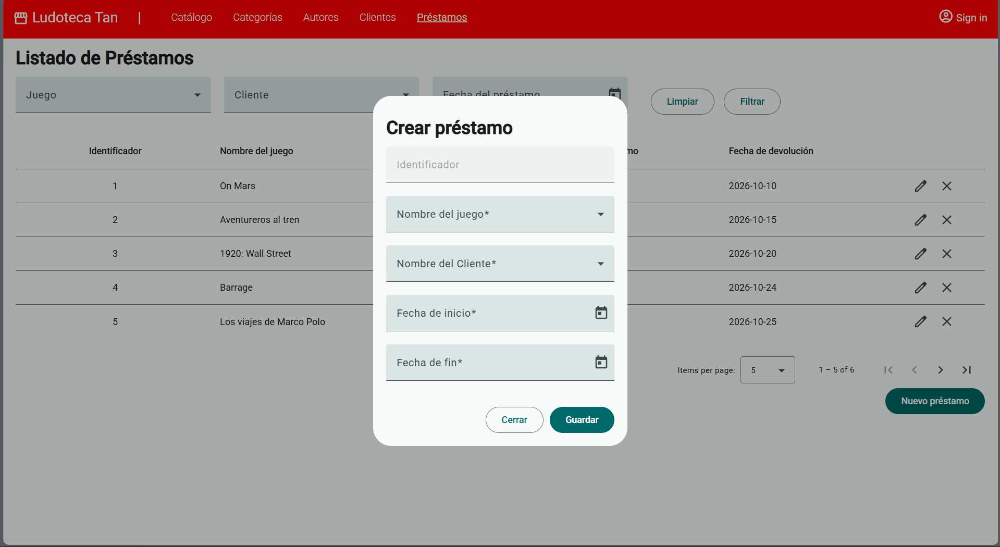

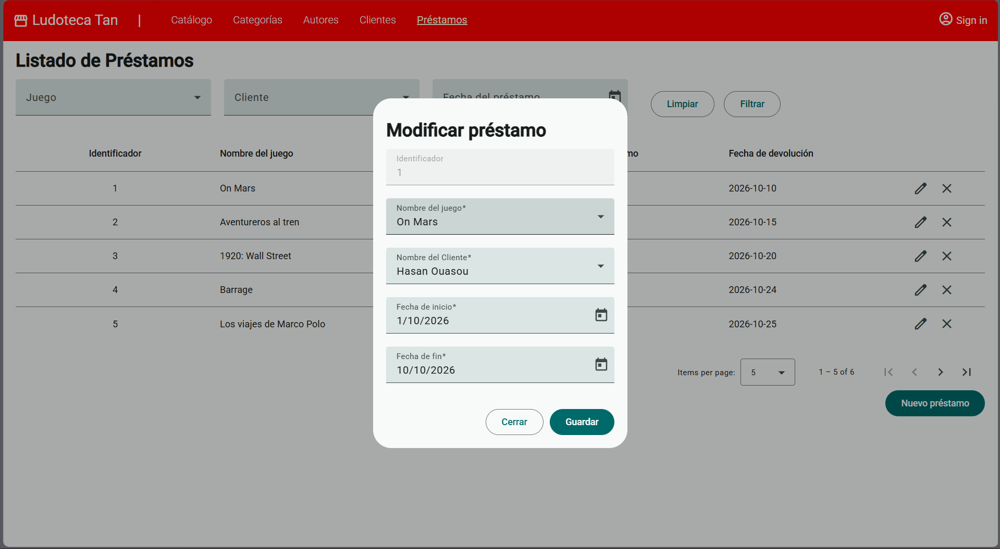

## Organización relacionada

- `src/app/client/`: listado, formulario, servicio y modelo de clientes.
- `src/app/loan/`: listado, formulario, servicio y modelo de préstamos.
- `src/app/core/`: elementos compartidos, como la cabecera, la confirmación de borrado y los modelos de paginación.
- `src/app/app.routes.ts`: rutas de la aplicación; `/clients` y `/loans` cargan las páginas explicadas arriba.
- `fotos/hazlotu/`: capturas utilizadas en esta guía.

Los datos de clientes y préstamos se obtienen y modifican mediante peticiones HTTP al backend; no son solo datos locales del frontend.
